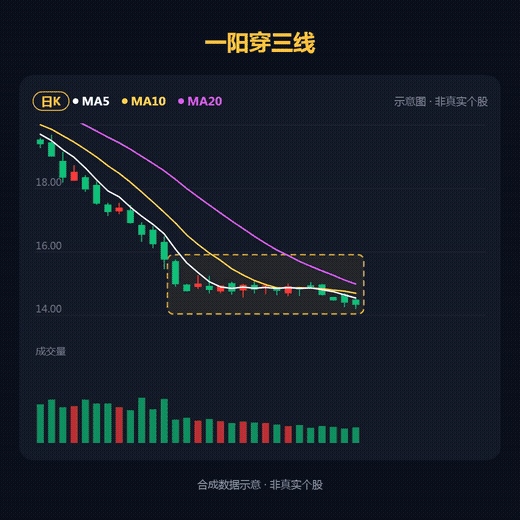
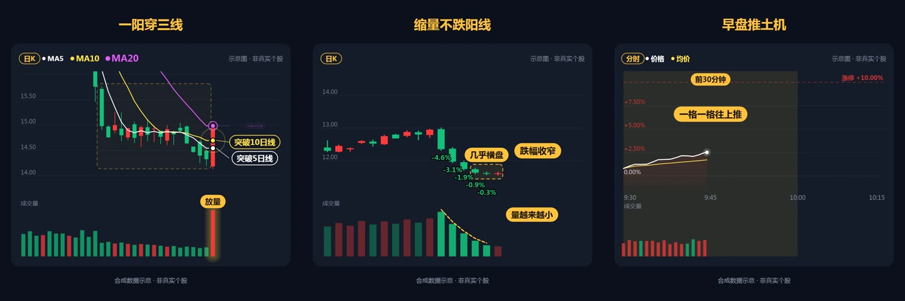

# 量价图表：K线突破与分时动画

量价教学图表独立组件，包含两组日K与一组分时动画。

**1:1 · 1080 × 1080 · 30 fps · v1.0.0** · [@oubaba95128](https://motiongit.com/@oubaba95128) · [English](README.md)

**[模板详情、完整 .motion 与 Demo](https://motiongit.com/@oubaba95128/volume-price-kline-charts)**
https://motiongit.com/@oubaba95128/volume-price-kline-charts

下载已开放，当前许可见模板页面与下载包。

## Demo

[查看完整样片](https://motiongit.com/@oubaba95128/volume-price-kline-charts) · [播放视频](https://media.openaicut.com/previews/869/1.0.0-zh-d5fd83bc28a8.mp4)

## 技术原理

- 声明的运行配置：html-canvas/1。
- 通过模板参数和预设，将本期文字、数据或素材映射到已有动画工程。
- 已声明时间轴为固定时长，本期内容按现有场景顺序和节奏适配。

样片时长: **49.2s**. 已声明输出为 1080 × 1080，30 fps；公开样片 49.2 秒。 按实际包的参数边界制作；增加素材不会自动增加场景。

## 输入素材与内容

- **可选:** Title1：文字，不超过 12 个字符。
- **可选:** Title2：文字，不超过 12 个字符。
- **可选:** Title3：文字，不超过 12 个字符。
- **可选:** Upcolor：文字。
- **可选:** Downcolor：文字。
- **可选:** Accentcolor：文字。
- **可选:** Backgroundcolor：文字。

适用内容: 量价关系教学 · 图表插入镜头

## 运行环境

- 声明的运行配置：html-canvas/1。具体工具与版本以下载包为准。
- 按下载包的依赖锁和 setup/check 说明检查已有工具，只补齐缺项，并验证预览。

## 使用模板

1. 从[模板页面](https://motiongit.com/@oubaba95128/volume-price-kline-charts)获取当前版本的完整 .motion。
2. 按包内说明解压或加载，读取 README 和引用的制作指南。
3. 使用本期内容与素材，复用已有环境，按包内入口制作并查看实际预览。

可将下面这段请求与仓库地址交给助手：

> https://github.com/motiontemplates/287792
>
> 请使用这个 .motion 模板制作。模板地址：https://motiongit.com/@oubaba95128/volume-price-kline-charts。取得模板后按其说明解压或加载，读取包内 README 和引用的指南，复用已有环境，用我的内容制作并展示实际预览。

## .motion 格式

MotionGit .motion 是可复用的视频模板格式，组织动画工程、参数、素材、依赖与制作指南。运行时按本期内容再次制作，输出 MP4 等成片。 [格式说明](https://motiongit.com/spec)

[版本、许可与完整下载](https://motiongit.com/@oubaba95128/volume-price-kline-charts) · [制作参考](ASSISTANT.zh-CN.md)
